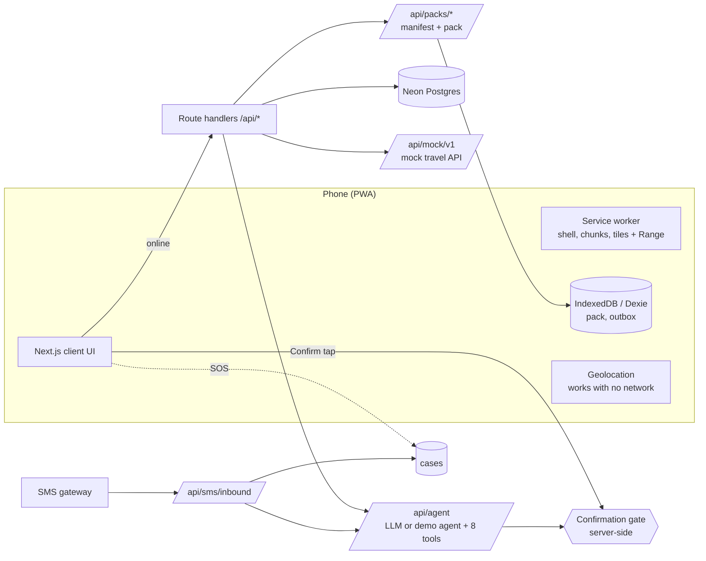

# Safar Saathi

An installable travel app (PWA) for first-time international travellers from India. Browse and book **sample** holiday packages, then keep going after payment:

1. **AI trip agent** answers trip questions and changes bookings (rebook a flight, extend a hotel stay) **only after the traveller taps Confirm**. The server enforces this; the model cannot commit a change on its own.
2. **Offline pack** built from each booking and stored on the phone: day plan, rule-based help for six common problems, offline map, saved routes, GPS position. Works with no mobile data.
3. **SMS fallback**: with cellular signal but no data, the traveller can reach a human. A simulator page runs the same flow without a gateway.

> **Honesty rules** (code, UI, README and demo follow these)
> - All inventory is **our own mock travel API with sample data**, shaped like a marketplace. No live airline/hotel integrations, no real bookings, no real payments. A "Sample data" label is always visible.
> - Offline guidance is **predefined and derived from the booking**. It does not update live while offline and never invents gates, delays or wait times.
> - SMS works over **cellular signal, not mobile data**, and not in airplane mode. A web app cannot send an SMS silently: the traveller taps Send.
> - Maps use OpenStreetMap data with visible attribution (© OpenStreetMap contributors). No Google Maps for offline, no bulk tile download from tile.openstreetmap.org.

## Run it now (no keys needed)

Requires Node 20+. With no `DATABASE_URL`, the app uses **PGlite** (real Postgres in WASM, stored in `.data/pglite`), and with no `LLM_API_KEY` it uses a clearly-labelled **demo agent**.

```bash
npm install
npm run db:reset        # drops, migrates, seeds 25 destinations, 111 itineraries, ~99k flights, demo trip
npm run build && npm start   # production build: the service worker (offline) only runs in production
# open http://localhost:3000  →  the catalogue. "Demo: open Neha's trip" signs in as Neha (Paris → Rome for 4)
```

`npm run dev` works for everything except offline behaviour. Stop the server before `db:reset` (PGlite allows one process at a time). After changing `lib/db/schema.ts`: `npm run db:generate`, then `npm run db:reset`.

Demo accounts (Login page): **Neha** (traveller), **Support agent**, **Admin**. Admin pages: `/admin/cases` (inbox), `/admin/sms-sim`, `/admin/reset`.

## Workflow v2 (the revision)

1. **Home is the catalogue** (`/`): 100+ sample itineraries, every card tagged Sample. The scroll story is at `/story`.
2. **Select this trip** creates a *draft* (`trip_drafts` + a draft booking) and starts the offline bundle immediately, **before payment**. The detail page shows the offline size and time first.
3. **Per-trip cache** (`ss-trip-{ref}-v{n}`, plus IndexedDB stores `trips`, `tripPacks`, `rulesets`, `fileRecs`, `outbox`): order is details+rules+routes, then map files; every file is SHA-256 checked, unchanged files are copied from the previous version, interrupted downloads resume, and the active version flips only after everything verified (atomic swap). Deleting a trip removes only its own namespace.
4. **Rules are drafted once by an LLM, validated, then frozen** (`lib/rules/`): Zod schema (unknown fields fail), seven validators (schema, references, coverage, no invented facts, length/tone, local script, safety), one retry with the errors, then the **template rule set** labelled *Standard guide, not personalised yet*. Offline, only the stored rules run; the interpreter never calls a model. All LLM calls live in `lib/llm/index.ts`.
5. **Payment** (`POST /api/trips/:ref/pay`) confirms the booking. Changes need a booked trip.
6. **Agent options** (`quote_change` with up to 3 `newFlightIds`): each option has a price breakup that must sum to the total, a source ("Sample data (mock API)" or a named provider with a validity time) and Yes / No. Yes goes through the same single-use-token gate.
7. **After a confirmed change** the server job `refresh_offline_pack` (not callable by the model) redrafts only the affected scenarios (hotel change → hotel scenario; flight change → the two flight scenarios), validates, publishes version n+1 and the phone swaps atomically. If it fails the old guide stays active and the traveller is told.
8. **Providers** (`lib/providers/`): the mock is always on; Duffel (official API, your key) is an optional search-only STUB; `search_web` (Tavily/Brave) gives sourced information, never prices. Nothing scrapes travel sites; a test fails the build if any source mentions such hostnames.
9. **Offline SOS**: address card and emergency number first, a prefilled SMS draft, and a case saved on the phone with a local id that uploads to `POST /api/cases` when data returns (idempotent).

## The landing story (`/story`)

A scroll story modelled on the reference site's structure and motion, with an **airliner in place of the ironing board**. Smooth scroll (Lenis), pinned sections (GSAP ScrollTrigger) and one shared Three.js stage (`lib/story/stage.ts`). The aircraft is built entirely in code (`lib/story/airplane.ts`): lathe fuselage with a painted livery texture, lofted swept wings with winglets, tailplane and fin, engines with fan discs, retractable gear, nav lights, steam trails. Beats: loader → hero (plane + trailing banner that goes from wrinkled to flat, headline swaps, take-off, dive into the green glow, rotating one-liners, quote) → "four capabilities" with a morphing banded ring → marquee band → "ready-made trips" (trip cards slide out of the cabin door; links go to real itineraries) → stat cards over a top-down plane → "why" tiles with drawn connectors → scenario cards → closing CTA with a nose-up plane. Falls back to a plain layout with reduced motion or no WebGL2. The reference theme (Geist + Geist Mono, `#0a0c10`, `#00ff85`, `#e9eceb`) is applied app-wide through the design tokens in `app/globals.css`. All copy is original and about Safar Saathi; the scenario cards are labelled as illustrative, not reviews.

## Adding your keys later

Copy `.env.example` to `.env.local` (and to Vercel project env). Every service has a working fallback until its key is set.

| Variable | What it switches on | Until it is set |
|---|---|---|
| `DATABASE_URL` (Neon **pooled**), `DATABASE_URL_UNPOOLED` | Neon Postgres. Then `npm run db:reset` against a Neon **dev branch** | Local PGlite |
| `AUTH_SECRET` | Signs session cookies | A dev-only default (set it in production!) |
| `RESEND_API_KEY` | Emails the sign-in code | **STUB**: code printed in the server log and shown on the login page in dev |
| `LLM_PROVIDER` (`anthropic`/`openai`/`openrouter`), `LLM_API_KEY`, `LLM_MODEL` | The real tool-calling agent **and** the LLM rule drafter | **STUB**: demo agent through the same gate; **template rule set** ("Standard guide, not personalised yet") |
| `DUFFEL_API_KEY`, `FX_TO_INR` | Live flight offers (search only) from Duffel's official API, labelled "Live price from Duffel, valid until…" | Mock only. Booking through a live provider is not wired (STUB) |
| `TAVILY_API_KEY` or `BRAVE_API_KEY` | `search_web` tool for travel information with sources | The tool says search is not configured |
| `ROUTING_API_KEY` (OpenRouteService) | Real road routes in the pack, computed **at build time only** (overrides the pre-built OSM route cache) | The pre-built OSM route cache (`lib/seed/route-cache.json`), then a flagged straight-line sample |
| `BLOB_READ_WRITE_TOKEN`, `TILES_BASE_URL` | Serve PMTiles city extracts from Vercel Blob | Serve from `/tiles` |
| `SMS_PROVIDER` (`sim`/`twilio`/`msg91`), `TWILIO_*`, `SMS_GATEWAY_NUMBER`, `PUBLIC_URL` | Real inbound/outbound SMS (Twilio adapter: signature check + REST send) | Simulator only. MSG91 is an adapter **STUB** |
| `PRICE_LIMIT_INR` (25000) | Above this, changes cannot be confirmed; a human is asked instead | n/a |
| `DEMO_MODE` / `NEXT_PUBLIC_DEMO_MODE` | Demo login, `?chaos=price_move`, GPS simulator buttons. **Set both to `false` in production** | on |
| `CRON_SECRET` | Protects `/api/cron/maintenance` (deletes SMS bodies after `SMS_RETENTION_DAYS`, default 30) | open |

### The offline map (real OpenStreetMap, built once, stored in the repo's `public/`)

A consumer-style street map that works in airplane mode, with GPS: street and area names, building footprints, parks, water, rail, one-way arrows, and POI icons (cafés, museums, hotels, hospitals, transit stops). Pins mark your hotel, airport and the landmarks on your plan, and saved routes follow real roads and footpaths with turn-by-turn steps.

| Piece | Source | How it is built | Size |
|---|---|---|---|
| Street tiles, 25 cities | OpenStreetMap via the Protomaps daily build (PMTiles, vector) | `npm run tiles:build` (needs `brew install pmtiles`; resumable). **Two files per city**: `<city>.pmtiles` overview (whole city + airport, zoom 0–12) and `<city>-core.pmtiles` (hotels + landmarks, street level, zoom 0–15) | about 5 to 25 MB per city, 237 MB for all 25 (a two-city trip stores about 30 to 45 MB) |
| Label fonts + POI icons | Protomaps `basemaps-assets` (Noto Sans, OFL; sprites, CC0) | `npm run map:assets` | 3.4 MB, shared by every trip |
| Real routes | OpenStreetMap routing from the public FOSSGIS OSRM servers (car + foot), 1 request at a time, build-time only | `npm run routes:cache` writes `lib/seed/route-cache.json`; the pack builder reads it. **No routing call ever runs on a phone.** `ROUTING_API_KEY` (OpenRouteService) still takes priority if set | about 10 MB file, a few KB per saved route |

**The tile files (about 250 MB) are not committed to git** (`public/tiles/*.pmtiles` is ignored; only `public/tiles/manifest.json` is). After cloning, run `npm run tiles:build` (about 25 minutes, resumable) or restore them from Blob storage. The fonts, icons, photos and the real-route cache (`lib/seed/route-cache.json`) are committed.

After changing any of these: `npm run db:reset` (or `npm run routes:build` to rebuild packs). The style lives in `lib/map/style.ts` (light + dark, local glyph/sprite/tile URLs only; a unit test fails if a remote URL appears). The same map is shown on every itinerary page before booking (`components/map/PreviewMap.tsx`). Upload `public/tiles/*` to Vercel Blob for production and set `TILES_BASE_URL`. Attribution "© OpenStreetMap contributors" is always visible; the tiles never come from tile.openstreetmap.org.

Limits, said plainly: no live traffic or transit times, no address search offline, no on-device re-routing (the app warns when you leave the saved route), and navigation pauses when the browser is in the background. Outside the saved area the GPS dot still works but there is no street map.

### Photos of the real places

`npm run images:fetch` downloads openly licensed photos (CC BY, CC BY-SA, CC0, public domain) from Wikimedia Commons for the landmarks (about 130 of the 160 landmarks; places without an honest match show gradient art), keeps author, licence and file-page link, and shows the credit on every photo. Wrong-place matches were reviewed by hand and are listed in `REJECT`; hand-picked fixes are in `PICKS` (`scripts/fetch-place-images.ts`). Hotels are fictional sample data and have no photo. Photos are part of each trip's offline bundle.

### Changing a flight: your own booking platform, then Confirm

Flight changes no longer use sample inventory. Ask the agent to move, reschedule, rebook or cancel a flight and it shows a **platform card** (`components/chat/PlatformCard.tsx`): your booked flight, then **MakeMyTrip, Goibibo, Cleartrip and ixigo** buttons that open each platform's own flight page (same route and day) or "my trips" page in a new tab. You log in there yourself and change the ticket. Back in the app you enter the new flight (airline, number, times, PNR, fare difference and change fee you paid), which creates a **review card**; only your Yes tap updates the trip, the totals and the offline guide (`flight_external` in `lib/gate/changes.ts`, no price limit because we charge nothing, recorded as an `external` payment).

**What this cannot do, and why.** These four platforms have no sign-in or booking API for other apps (their APIs are for contracted business partners), so Safar Saathi **cannot log in to them, read your booking, or change/cancel a ticket for you**, and it never asks for or stores a platform password. "I am logged in" is your own note (`provider_connections`) so the agent remembers which platform you use. Real in-app booking needs a partner agreement and an official API adapter in `lib/providers/` (the adapter shape is ready); until then this link-out plus confirmed record is the honest version. `lib/providers/platforms.ts` only builds links and a test fails if it ever fetches or handles credentials. Hotel-stay extension still uses the labelled sample inventory.

### Bangalore demo trip (GPS)

Two domestic itineraries (`bangalore-3n-standard-culture` from Delhi, `bangalore-3n-budget-family` from Mumbai) and a ready demo booking `SS-56001` that starts today, so the trip is "happening now". Open it from the first page ("Demo: Bangalore trip (GPS)"), go to **Map**, tap **Show my location**: the blue dot appears on the real Bengaluru street map (works with no data). If you are outside the saved area the map says so. The tiles cover Cubbon Park, Vidhana Soudha, Lalbagh, Bangalore Palace and the airport road (BLR). 26 cities, 906 saved real routes.

### Agent desk and SOS texts

`/agent` is the agent's dashboard: every SOS tap from the app, every text to the helpline number and every help request from the chat appears as an alert (newest and most severe first) with traveller, trip, masked phone, last GPS location (OpenStreetMap link) and a 60 s SLA countdown for emergencies. New alerts raise a red banner, optional alarm sound and browser notification; "Take over" and "Mark resolved" are human-only actions. The first page (`/`) has **Travel user login** and **Agent login** side by side.

**Twilio (live SMS).** Set `SMS_PROVIDER=twilio`, `TWILIO_ACCOUNT_SID`, `TWILIO_API_KEY_SID` + `TWILIO_API_KEY_SECRET` (or `TWILIO_AUTH_TOKEN`) and `SMS_GATEWAY_NUMBER`. A traveller texts that number, e.g. `SOS lost passport SS-48213`. A local machine has no public webhook URL, so the server **reads the text from Twilio** (a free GET of new inbound messages, `lib/sms/poll.ts`) whenever an agent desk is open (or from `/api/cron/sms-poll`), runs it through the same severity rubric as the app, opens a case and the desk alerts. For a deployed app you can instead point the Twilio number's webhook at `/api/sms/inbound` (needs `TWILIO_AUTH_TOKEN` and `PUBLIC_URL` for the signature check). Unknown senders without a booking ref still raise an alert.

**Message budget.** Replies are the only SMS this app sends; every real send is counted in `sms_messages` and refused after `TWILIO_SEND_CAP` (default 5). The caps are enforced in code and tested (`tests/unit/twilio-sms.test.ts`, all with a mocked Twilio; automated tests can never send because the e2e config forces the simulator). Trial accounts can only text verified numbers.

### Offline assistant (rule-based, no model)

The chat falls back to `lib/offline/assistant/` when the phone is offline, when you turn on the "Offline assistant" chip, or when the online agent is unreachable. It answers from the saved pack only: your hotel, flights, pickup, today and tomorrow, emergency numbers and consulate, plus built-in basics for each destination (currency, tipping, plugs, SIM, safety) and the six problem-solving guides (flight delayed, missed connection, hotel not found, transfer no-show, lost passport, medical help) and standard guidance for lost luggage, lost phone or wallet, and scams. It understands typos and a few Hinglish phrases, says "I can't answer that offline" when unsure, and can never book or change anything (changes need a connection and your Confirm tap).

### Deploy to Vercel

1. Create a Neon project with `main` and `dev` branches; copy the pooled and direct connection strings.
2. `vercel link`, add the env vars above (production: `DEMO_MODE=false`, `NEXT_PUBLIC_DEMO_MODE=false`, a real `AUTH_SECRET`).
3. Against the target database: `DATABASE_URL=… DATABASE_URL_UNPOOLED=… npm run db:reset` (seeds the catalogue; set `DEMO_MODE=true` if you want the demo accounts there).
4. `vercel --prod`. `vercel.json` registers the daily maintenance cron.

## How it works



**The confirmation gate** (`lib/gate/`): the model can call `quote_change` but never receives or creates a token. The traveller's **Confirm tap** calls `POST /api/confirmations` (session + ownership + quote expiry + quote hash checked), which mints a random single-use token and stores **only its hash** (5-minute expiry). `POST /api/mock/v1/changes/apply` re-checks the token, expiry, quote hash and the **live price**. If the price moved: `409 PRICE_CHANGED`, the old token is void, a new review card is shown. Above `PRICE_LIMIT_INR`: blocked, escalate to a human. Applying rebuilds the offline pack (version +1). Tests prove that apply fails with no token, a reused token, an expired token and another booking's token.

**The offline pack** (`lib/packs/`): `buildPack` is a pure function of the booking, run on booking and after every confirmed change. The phone fetches the manifest, diffs files by hash, downloads with progress, verifies sha256 (the pack's `contentHash` is re-computed on the phone), then swaps versions atomically. Pages and JS chunks are cached by the service worker (it scans chunks for lazily-loaded map code). Pack budget: 80 MB per trip (`PACK_BUDGET_MB`); over budget offers "Download maps over Wi-Fi".

**Three network states** (`lib/offline/network-state.ts`): Online (heartbeat to `/api/health` every 3 s) · Signal only (heartbeat fails, traveller confirms "I have signal") · Offline pack. SOS changes with the state: "Talk to a human" / "Send SOS text" (prefilled `sms:` link, traveller taps Send) / "Queued, will send when you have signal".

**Rule engine** (`lib/rules/`): six JSON decision trees (flight delayed, missed connection, hotel not found, transfer no-show, lost passport, medical help) with `{{templates}}` filled from pack data. The interpreter is under 5 KB. No model, no network.

More: [docs/architecture.md](docs/architecture.md) · [docs/mock-api.md](docs/mock-api.md) · [docs/demo-script.md](docs/demo-script.md)

## Tests

```bash
npm test                      # 111 unit tests (Vitest, in-memory Postgres, fake IndexedDB)
npm run build && npm run test:e2e   # 6 Playwright tests against a production build
```
Unit: seed determinism and counts, gate (no/reused/expired/foreign token, tampered quote, price move, over limit, hotel extension), rule engine (every template resolves in every city), severity rubric, off-route detector, agent tools and demo agent, the real LLM path with a mock model, SMS inbound.
E2E: search → book → pack downloads → **airplane mode** → guide, address card, map, GPS dot, SOS with no failed requests; pickup question cites the booking; Decline leaves the booking unchanged; `price_move` → 409 → new card → Confirm → receipt → pack +1; direct apply with no token / reused token rejected; SMS "SOS lost passport SS-48213" → severity-1 case + reply with case ID.

## What is stubbed or different from the brief (honest list)

- **LLM**: without `LLM_API_KEY` a keyword-matching demo agent runs (labelled in the chat UI). The real path (`lib/agent/run.ts`) is tested with a mock model and was smoke-tested once against Gemini through OpenRouter.
- **Auth**: signed-cookie sessions (`jose`) with demo login and an email one-time-code flow instead of Auth.js v5 (smaller, no adapter tables, easy to swap later).
- **Service worker**: hand-written `public/sw.js` instead of Serwist, to control Range requests for PMTiles and chunk discovery exactly.
- **Data fetching**: plain `fetch` (no TanStack Query yet). Dexie is used for the offline pack as specified.
- **Map and routes**: real OpenStreetMap tiles and real road/footpath routes are pre-built into the repo (see "The offline map"). The routes come from the public FOSSGIS OSRM servers (a community service, so they are fetched once, politely, at build time). A pair missing from the cache falls back to a labelled straight-line sample. On-device A* rerouting is Phase 2; the MVP shows an off-route hint (more than 40 m for 10 s).
- **Severity-1 paging**: marks the case with a 60 s SLA in `/admin/cases` and logs it. No pager integration (`lib/server/cases.ts`).
- **Voucher**: printable page built from the pack (save as PDF). No emailed PDF or Vercel Blob upload yet.
- **Rate limiting**: in-memory per server instance (best effort). Swap for Upstash/Vercel KV in production.
- **Not built (Phase 2)**: Hindi UI/voice, Capacitor wrapper, on-device road graph, offline place search, India DLT SMS compliance.
- **Emergency numbers / consulate contacts** are sample data. Numbers not verified are marked "Sample, confirm locally".
- Offline limits, said plainly in the UI: no live traffic or transit, no address search offline, no background navigation in a PWA, iOS may evict storage (we request persistent storage and warn on low space).
