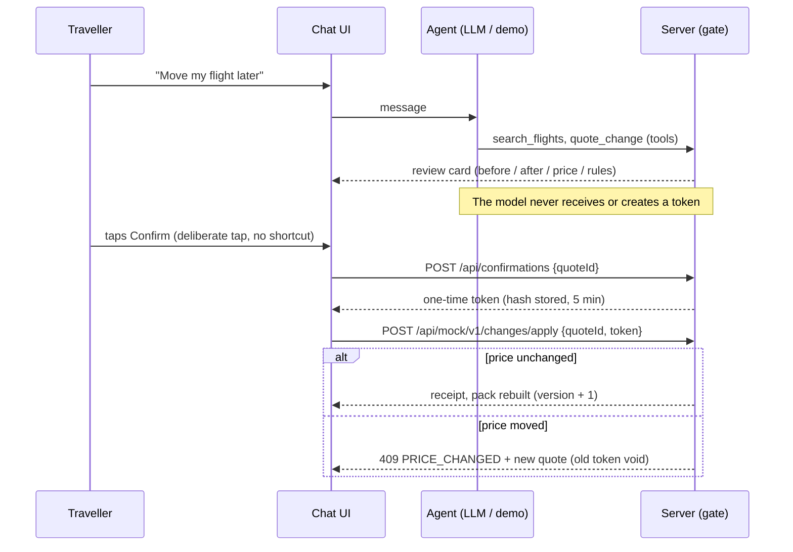

# Architecture

## Layers

| Layer | Implementation |
|---|---|
| UI | Next.js (App Router), Tailwind v4 with CSS-variable tokens (dark default, light "Outdoor" theme), Lucide icons |
| API | Route handlers in `app/api/*`; every input validated with Zod |
| Data | Drizzle ORM. Neon over WebSocket pool when `DATABASE_URL` is set, otherwise PGlite (`lib/db/client.ts`) |
| Agent | Vercel AI SDK `streamText` + 8 tools (`lib/agent/tools`), or the labelled demo agent. Streams NDJSON events: `thread`, `step`, `text`, `review`, `case`, `route`, `receipt`, `done` |
| Gate | `lib/gate` (`tokens.ts`, `changes.ts`): quotes, single-use tokens (hash only), re-check on apply |
| Offline | `lib/packs` (builder, manifest), `lib/offline` (Dexie, sync, outbox, network state), `public/sw.js` |
| Rules | `lib/rules` (engine < 5 KB, six scenarios as JSON) |
| Map | MapLibre GL JS + PMTiles protocol, style built in code from the pack (`lib/map/style.ts`), routes (`lib/map/routes.ts`), off-route (`lib/map/offroute.ts`) |
| SMS | Adapter interface (`sim`, `twilio`, `msg91` stub) + shared inbound handler |

## Confirmation gate sequence

## Network states

| State | Detected by | Behaviour |
|---|---|---|
| Online | `navigator.onLine` + 3 s heartbeat to `/api/health` | Full agent, changes, sync |
| Signal only | Heartbeat fails + traveller taps "I have signal" | Offline pack + SOS opens a prefilled SMS |
| Offline pack | Heartbeat fails | Offline pack only; SOS is queued in IndexedDB and sent when online |

## Service worker caches (`public/sw.js`)

- `ss-shell-v1`: `/offline` and trip pages (client-rendered shells, no personal data in the HTML), network-first with a 4 s timeout.
- `ss-static-v1`: `/_next/static/*` (immutable), cache-first. The worker scans chunks for lazily-loaded chunk names.
- `ss-pack-files`: PMTiles + `/map/*` files, with HTTP **Range** support (slices the cached full file). Survives SW upgrades.
- `/api/*` is never cached by the worker. The pack is stored by the app in IndexedDB.

## Data model

See `lib/db/schema.ts`. Catalogue (`destinations`, `pois`, `itineraries`, `itinerary_days`, `flights`, `hotels`, `room_inventory`, `transfers`), booking (`users`, `travellers`, `bookings`, `booking_items`, `payments`), agent and safety (`agent_threads`, `agent_messages`, `tool_calls` = the action log, `change_quotes`, `confirmations`, `cases`, `sms_messages`), offline (`offline_packs`), analytics (`events`), plus `login_codes`.

## Success metrics as events

`events` rows: `agent_answer_time` (server, per answer), `pack_ready` (client, ms to download and verify), `offline_answer` (client, ms to show a guide screen), `sos_tap`, `install_prompt`, `case_opened`, `change_applied`, `booking_created`.
